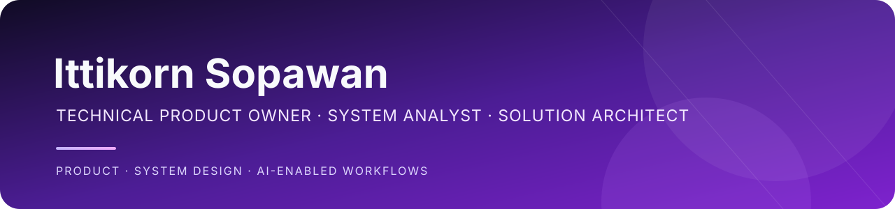

  

  

  <a href="https://github.com/ittikornsopawan">GitHub</a>
  &nbsp;·&nbsp;
  <a href="mailto:ittikorn.sopawan@gmail.com">Email</a>

## ✨ Highlights

- Improved billing data accuracy from near-zero to **over 90%** through workflow redesign and validation.
- Designed multi-cloud ELT pipelines across **AWS, Google Cloud, and Huawei Cloud** for unified billing insights.
- Led system design for **manufacturing and logistics**, covering factory operations and distribution workflows.
- Delivered enterprise products across billing, loyalty, contract renewal, approval workflows, and access control.

## 🧭 Core Focus

- **Product & business analysis:** requirements, product ownership, workflows, use cases, and stakeholder alignment.
- **System & solution architecture:** microservices, REST APIs, DDD, data models, and cross-platform integration.
- **Data & AI:** ELT/ETL pipelines, data validation, AI-assisted workflows, and RAG applications.

## 💻 Tech Stack

### Languages & Backend

  

### Frontend & Mobile

  

Also experienced with React Native.

### Data & Cloud

  

Also: SQL Server · Huawei Cloud · ELT/ETL

### Delivery & AI

  

REST APIs · Microservices · CI/CD · Claude Code · Codex · Hermes Agent

## 💼 Experience

### System Analyst Supervisor · Socket9
**Jun 2024 – Present**

- Translate business needs into workflows, use cases, system architecture, database schemas, and API specifications.
- Lead system design for manufacturing and logistics, review technical solutions, and collaborate with clients, analysts, and engineering teams.
- Support pre-sales and team onboarding; use Claude Code, Codex, and Hermes Agent to accelerate design, documentation, and prototyping.

### Senior System Analyst & Product Owner · True IDC
**Nov 2022 – May 2024**

- Gathered product requirements and designed multi-cloud ELT pipelines across AWS, Google Cloud, and Huawei Cloud.
- Created validation workflows and a mini application to verify business logic before implementation, helping improve billing data accuracy from near-zero to **over 90%**.
- Designed database schemas and API specifications for cross-platform integration.

### Solution Architect · Buzzebees
**Nov 2021 – Oct 2022**

- Designed transaction integrations and standardized REST APIs for loyalty points processing.
- Evaluated e-commerce APIs and modernized applications from .NET Framework to .NET 5.

### System Analyst · True Corporation
**Jan 2021 – Oct 2021**

- Designed a contract-renewal system with personalized, promotion-based offers using DDD and microservices.
- Defined API ownership and data mapping, and led cross-functional Scrum activities.

### System Analyst · Pruksa Real Estate
**Aug 2019 – Dec 2020**

- Designed approval workflows, SQL Server schemas and stored procedures, and K2 BlackPearl integrations.
- Built workflow-driven applications with ASP.NET MVC and SQL Server.

### .NET Full-Stack Developer · PTT Digital
**Jul 2016 – Jul 2019**

- Developed an online access-control application using .NET MVC and SQL Server.
- Optimized stored procedures and supported UAT, defect fixes, and production releases.

## 🎓 Education

**Bachelor of Computer Engineering** · Rajamangala University of Technology Thanyaburi · 2013

  

